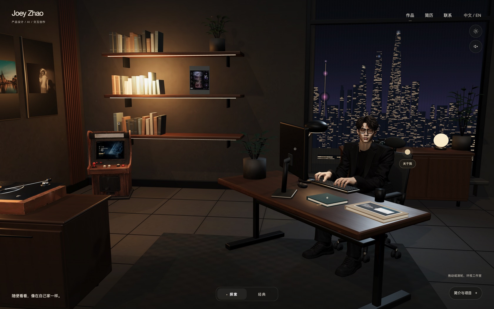
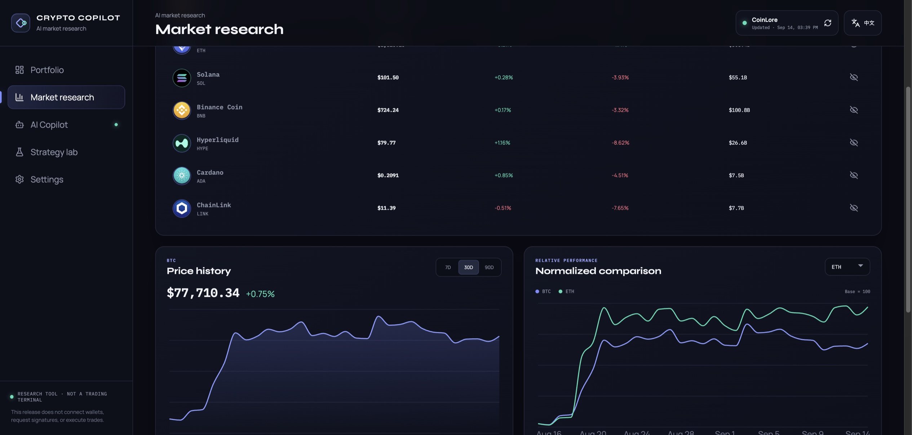
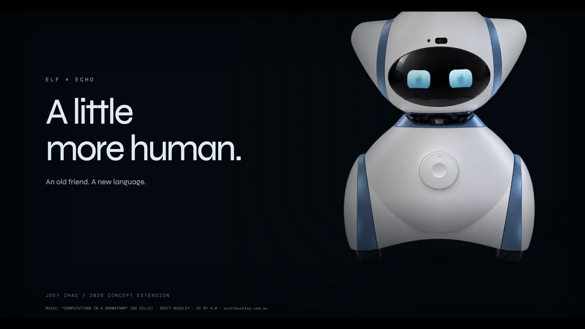

<h1 align="center">Joey Zhao · 赵越</h1>

Senior AI Product Designer · AI Agent UX &amp; Enterprise SaaS · Shanghai

  <strong>Designing the feeling. Shipping the system.</strong> 
  <em>把感觉做出来，把产品发上线。</em>

  <a href="https://joeyzhao.cc">Portfolio</a> ·
  <a href="#joey-design">Joey Design Skill</a> ·
  <a href="https://www.linkedin.com/in/joey-zhao-b8576b91/">LinkedIn</a> ·
  <a href="mailto:super666joey@gmail.com">Email</a> ·
  <a href="https://github.com/joeymilano?tab=followers">Followers</a>

---

I’m a product designer and AI builder. I like taking an idea from the **first question to a product people actually use** — strategy, interaction, visual language, frontend, AI behavior, with my hands on all of it. My work spans [**@joeymilano**](https://github.com/joeymilano) and [**@JoeyZhaoUX**](https://github.com/JoeyZhaoUX): AI-native products, onchain tools, consumer apps, browser extensions, robots with a face, plus the occasional experiment that fits no category.

我是产品设计师，也是 AI Builder。习惯把一个还说不清的想法，一路推到真的有人肯用，产品判断、交互、视觉、前端，还有 AI 的行为方式，都自己上手过一遍。作品放在 [**@joeymilano**](https://github.com/joeymilano) 和 [**@JoeyZhaoUX**](https://github.com/JoeyZhaoUX)，从 AI 原生产品、链上工具、消费级应用、浏览器扩展，到有表情的机器人，偶尔也做点没法归类的实验。

> **No theatre decks. No fake demos. Products with a point of view, built to be used.**  
> **不做只停在 PPT 里的“概念产品”。放上来的东西，有立场，也都真的做出来了。**

[3D Studio](#featured-interaction--旗舰体验) · [最新上线](#new-from-the-studio--最新上线) · [Finfold](#featured-product--主打产品) · [代表作品](#selected-work--代表作品) · [Writing / 写作](#writing--写作)

## Featured interaction / 旗舰体验

  

### [The Interactive Studio — Explore Mode ↗](https://joeyzhao.cc/explore/)

**A portfolio you can walk into.** Explore mode turns joeyzhao.cc into a real-time WebGL studio. Drag, scroll, or use the arrow keys to look around, and click the room's objects — the arcade, the bookshelf, the camera, the notebook — to open the work where it lives. Eight exhibits inside, day/night themes, ambient sound, full EN/中文, and a classic view for readers in a hurry. Scene, interaction, copy, and code — one maker.

我的网站现在可以“走进去”看。「探索模式」把 joeyzhao.cc 变成一间实时 WebGL 工作室，拖动、滚轮或方向键就能环视这间夜景房间，点街机、点书架、点相机、点笔记本，作品就在它该在的地方打开。馆内八件展品，日夜主题、环境声、中英双语都有，赶时间的话还有「经典模式」。3D 场景、交互、文案、代码，都是我一个人做的。

  <a href="https://joeyzhao.cc/explore/"><strong>Walk into the studio ↗</strong></a>
  &nbsp;·&nbsp;
  <a href="https://github.com/joeymilano/portfolio.github.io/tree/main/explore">Explore the build ↗</a>

Inside the studio / 馆内展品：Finfold · Signals Notebook · CollovGPT · UnifyUX · Ctrip Hotel · <a href="https://joeyzhao.cc/vw-id-aura/">ID.AURA</a> · Borrowed Light · CALL ME YAO

---

## New from the studio / 最新上线

### Joey Design

我把做中文 PPT、Web / App 界面、作品集网站和小游戏的方法，写成了一个低 AI 味的开源 Skill，Codex 和 Claude Code 里都能用

[下载《折频》PowerPoint](https://joeymilano.github.io/joey-design/fold-deck-zh.pptx) · [用《底片台》选照片](https://joeymilano.github.io/joey-design/contact-sheet.html) · [逛《间室》作品集](https://joeymilano.github.io/joey-design/stillroom.html) · [玩《末班渡轮》](https://joeymilano.github.io/joey-design/last-ferry.html)

[Gallery / 在线展厅](https://joeymilano.github.io/joey-design/) · [Source & installation / 源码与安装](https://github.com/joeymilano/joey-design#installation)

### [Crypto Copilot ↗](https://joeyzhao.cc/cryptocopilot) · [live product ↗](https://crpto-copilot.pages.dev/)

  

**A bilingual onchain market-research workspace. The AI only says what the data supports.** Ticker panels stream live from Kraken and CoinLore, Workers AI answers stick to the numbers on screen, and backtests are reproducible, with the losing months kept on the record. Built with React 19, TypeScript, Vite, and Cloudflare Pages Functions. It never connects a wallet and never places an order. The product's job is judgment.

链上行情研究工作台，中英双语。行情接 Kraken 与 CoinLore 的实时数据，Workers AI 的回答只说这些数字撑得住的话；回测可以复现，亏钱的月份也原样留在记录里。不连钱包，不下单，它只负责帮人把行情看懂。

### [ELF × ECHO ↗](https://joeyzhao.cc/elf-echo/)

  

**A campus companion robot with a face you can read.** ELF rolls on a wheeled base and wears a screen for a face. ECHO, its interactive expression system, gives it a resting face, micro-expressions, and honest reactions when it gets a pat on the head, or a whole day of being ignored. From campus research and early sketches to final product renders, the design keeps to one idea. A robot earns companionship the way an old friend does, just by being there.

校园陪伴机器人。轮式底盘，一张屏幕当脸，表情系统叫 ECHO。它有安静的默认表情，被摸头会高兴，被晾一天会委屈，快没电的时候还会犯困。从校园调研、草图到产品渲染完整走了一遍。整个设计只讲一个想法，机器人要像老朋友，陪伴靠的是一直都在。

## Featured product / 主打产品

### [Finfold ↗](https://www.finfold.app) · [public repo ↗](https://github.com/joeymilano/Finfold)

  

**An AI growth operator that runs the whole loop.** Finfold watches what happened in your product, picks out the opportunities worth acting on, and turns one update into platform-native drafts for every channel. It replies to comments through its Chrome extension, and keeps score of what each action actually brought back — clicks, leads, signups, revenue. Brand Memory and Brand Rules keep the output sounding like the founder wrote it. A Letta-backed agent turns product notes into creation briefs. And Claude, GPT, or any custom agent can operate Finfold remotely over MCP with a revocable token.

  <a href="https://www.finfold.app"><strong>Open the live app ↗</strong></a>
  &nbsp;·&nbsp;
  <a href="https://github.com/joeymilano/finfold-growth-mission-api">Growth Mission API + MCP ↗</a>
  &nbsp;·&nbsp;
  <a href="https://github.com/joeymilano/finfold-growth-agent">NVIDIA Nemotron build ↗</a>
  &nbsp;·&nbsp;
  <a href="https://joeyzhao.cc/en/finfold">Design case study ↗</a>

Next.js on Cloudflare Workers · Chrome extension · WeChat mini program · Supabase · Letta · remote MCP server · Apache-2.0

---

## Selected work / 代表作品

| | Product | Why it matters / 它解决什么 |
| --- | --- | --- |
| ✦ | [**Finfold**](https://github.com/joeymilano/Finfold) | An AI content growth OS for solo founders going global. One insight in, native content out for RED, X, LinkedIn, Reddit. 为出海独立创业者做的 AI 内容增长系统，一次输入，多平台原生表达。 |
| ✦ | [**Bill Vampire**](https://github.com/JoeyZhaoUX/Bill-Vampire) + [**Gmail Patrol**](https://github.com/JoeyZhaoUX/bill-vampire-extension) | A privacy-first subscription-defense product and its Gmail companion. It identifies recurring charges, weighs the risk, and turns billing evidence into a response you can send. 隐私优先的订阅防御产品，附 Gmail 扩展。识别续费、判断风险，把账单证据变成一份能照着做的应对清单。 |
| ✦ | [**PORTFOLIO OS**](https://joeymilano.github.io/portfolio-os/) | A design-education AI agent that plans study-abroad portfolios like a strategist — built for the Alipay Agent Award, deployed and live. 像留学策略师那样帮设计学生规划作品集的 AI 智能体，支付宝智能体涌现奖参赛作品，已部署上线。 |
| ✦ | [**CALL ME YAO 妖**](https://joeyzhao.cc/yao/) | An AI-native girl group of four Journey to the West demons — one person, 36 scripts, from lyrics to YouTube release. 把《西游记》四只妖怪重组成 AI 原生女团。一个人，36 版脚本，从作词一路做到 YouTube 上线。 |
| ✦ | [**Finfold Growth Mission**](https://github.com/xagentAI/xagt-plugin/pull/34) | A Finfold-powered growth-mission plugin, merged into xagentAI/xagt-plugin — shipping agent workflows where agents live. 基于 Finfold 的增长任务插件，已合并进 xagentAI/xagt-plugin 官方仓库，增长工作流直接进了智能体平台。 |
| ✦ | [**MissionGet**](https://joeyzhao.cc/en/missionget-glasses) | A team prototype that takes a spoken request from AI glasses to phone review and a desktop workbench. 和 MissionGet 团队一起做的办公原型，眼镜上说出任务，手机里确认，到桌面工作台接着干。 |
| ✦ | [**魔都人生 · Shanghai Stories**](https://modulife.pages.dev/) | A browser life sim about arriving in Shanghai at eighteen, five cards in hand, with work, rent, and relationships to figure out. [Source](https://github.com/joeymilano/modu-life) 十八岁到上海，手里五张牌。找工作、付房租，也会遇见新的人。 |
| ✦ | [**Delivery Chaos · 猫手猫脚**](https://github.com/joeymilano/DELIVER-CHAOS) | An Unreal Engine game about a cat causing chain reactions in a Halloween living room. [Mac playtest](https://github.com/joeymilano/DELIVER-CHAOS/releases/tag/v0.1.0-mac-playtest) 用 Unreal Engine 做的万圣节拆家游戏，Mac 试玩版已开放。 |
| ✦ | [**Portfolio & Writing**](https://joeyzhao.cc) | Product thinking, experiments, and the work behind the work. 产品思考、实验，还有决定作品好坏的那些细节。 |

  AI-native products · Onchain tools · Robots with a face · Consumer tools · Expressive interaction · WebGL systems

## Writing / 写作

- [做 AI Agent，别只画页面](https://joeyzhao.cc/writing/ai-designers-cannot-only-sell-screens) — 用 Finfold、Signals 和 UnifyUX 讲 AI 工作流里的进度、证据和失败恢复。
- [从一个 Brief 到 14 个平台](https://joeyzhao.cc/writing/finfold-one-brief-eleven-platforms) — 从需求研究、渠道独立重试，到带着 Finfold 上台实演。

## My operating system / 我的工作方式

- **Start with behavior, not decoration.** Find the decision, friction, and feeling that actually move a person.  
  **先理解行为，再谈视觉。** 用户在哪儿做决定、在哪儿被卡住，设计就从哪儿下手。

- **Make the vague concrete, fast.** Prototype early, test the edge cases, and let the product answer the question.  
  **尽快把模糊的东西做出来看。** 早点出原型，多试边界情况，让产品自己给答案。

- **Hold the whole experience to one bar.** Product, brand, interface, code, and AI behavior should feel like they came from one mind.  
  **整个体验用同一把尺子。** 产品、品牌、界面、代码和 AI 行为，要像出自同一个大脑。

## Currently / 现在

Building an onchain market copilot, teaching a robot to make faces, evolving Finfold, and still chasing software that is both **useful** and **unforgettable**.

正在打磨链上行情 Copilot，教机器人练习表情，继续迭代 Finfold，也在琢磨软件怎么做到既**有用**，又**让人记住**。

---

  <strong>If you believe products win attention by being genuinely better, let’s talk.</strong> 
  <em>如果你也相信，东西做得足够好，注意力自己会来，欢迎来聊。</em>

