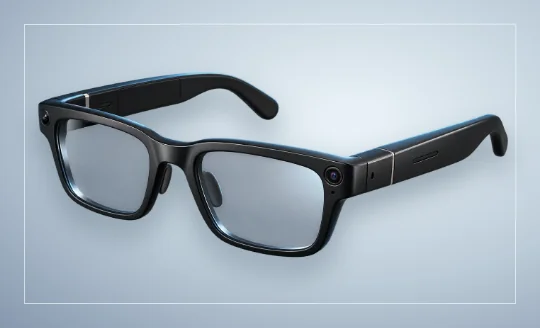

# Joey Zhao 赵越

**Senior AI Product Designer · Shanghai**

[**Enter the 3D studio ↗**](https://joeyzhao.cc/explore/) · [Portfolio](https://joeyzhao.cc/) · [LinkedIn](https://www.linkedin.com/in/joey-zhao-b8576b91/) · [Email](mailto:super666joey@gmail.com)

I design AI agents, enterprise SaaS, and design systems. I pay particular attention to the moments when an agent needs to show its progress, explain what it found, or hand a decision back to a person.

我在上海做 AI 产品设计，关注 Agent 交互、企业软件和设计系统。我最感兴趣的是人和 Agent 交接的那一步：用户怎样看清进度、核对依据，又能在需要时接手。

## Selected work / 代表作

  

### [Finfold](https://github.com/joeymilano/Finfold) · AI marketing agent

I built Finfold for small teams that need to turn one product update into channel-specific drafts. It surfaces opportunities, remembers brand rules, and gives people a review step before anything goes live.

一个产品更新，可以变成适合小红书、微信公众号和 LinkedIn 各自语境的草稿。发什么、什么时候发，由人决定。

[Try Finfold](https://www.finfold.app/) · [Design case study](https://joeyzhao.cc/en/finfold) · [Growth Mission API & MCP](https://github.com/joeymilano/finfold-growth-mission-api)

### [MissionGet](https://joeyzhao.cc/en/missionget-glasses) · AI glasses for office work

I worked with the MissionGet team on the product definition, interaction design, and prototype integration. The prototype lets you start a request by voice, review it on a phone, and continue in the desktop workbench.

戴着眼镜说出一个任务，在手机上确认，回到电脑继续做。这个原型关注的是三台设备之间怎么接得上。

[Try the interactive demo](https://joeyzhao.cc/en/missionget-glasses#try)

### [魔都人生 · Shanghai Stories](https://github.com/joeymilano/modu-life) · Life sim

A browser game about arriving in Shanghai at eighteen. You start with five cards and a series of choices about work, rent, and the people you meet.

十八岁到上海，手里五张牌。先找工作、先交房租，还是跟刚认识的人出去走走？

[Play in your browser](https://modulife.pages.dev/) · [Browse the source](https://github.com/joeymilano/modu-life)

<strong>More projects / 更多作品</strong>

- [The Interactive Studio](https://joeyzhao.cc/explore/) — Walk through my WebGL portfolio and open projects from objects in the room. [Source](https://github.com/joeymilano/portfolio.github.io/tree/main/explore)
- [Signals](https://joeyzhao.cc/signals) — Scientific software that helps researchers trace recommendations back to the experiments and materials behind them.
- [CollovGPT Pro Mode](https://joeyzhao.cc/collov) — AI interior design with controls for floor plans and targeted edits.
- [ID.AURA](https://joeyzhao.cc/vw-id-aura/) — A real-time WebGL cockpit concept for Volkswagen.
- [ELF × ECHO](https://joeyzhao.cc/elf-echo/) — An expressive interface for a campus companion robot.
- [Bill Vampire](https://github.com/JoeyZhaoUX/Bill-Vampire) and [Gmail Patrol](https://github.com/JoeyZhaoUX/bill-vampire-extension) — Tools for finding recurring charges in billing emails.
- [Crypto Copilot](https://joeyzhao.cc/cryptocopilot) — A market research workspace with live price data and reproducible backtests.
- [PORTFOLIO OS](https://joeymilano.github.io/portfolio-os/) — An AI planning assistant for design school applicants.
- [CALL ME YAO 妖](https://joeyzhao.cc/yao/) — A music video that reimagines four Journey to the West demons as a girl group.
- [Delivery Chaos 猫手猫脚](https://github.com/joeymilano/DELIVER-CHAOS) — A 3D cat mischief game with a Mac playtest.
- [Finfold for Nemotron](https://github.com/joeymilano/finfold-growth-agent) and [Growth Mission plugin](https://github.com/xagentAI/xagt-plugin/pull/34) — Two ways I brought Finfold’s workflows into agent platforms.
- [@JoeyZhaoUX](https://github.com/JoeyZhaoUX) — My other GitHub account with more projects.

## Writing / 写作

- [Designing AI Agents Beyond the Screen · 做 AI Agent，别只画页面](https://joeyzhao.cc/writing/ai-designers-cannot-only-sell-screens) — How I design progress, evidence, and recovery into agent workflows.
- [从一个 Brief 到 14 个平台](https://joeyzhao.cc/writing/finfold-one-brief-eleven-platforms) — What changed when I took Finfold from a design file to a live demo.

## Let’s talk / 聊聊

If you’re building an AI workflow and people keep getting stuck at one step, I’d love to hear which one. I’m also up for swapping notes on enterprise UX or indie games.

如果你在做 AI 产品，有个交互反复把用户卡住，欢迎带着具体场景来聊。也想认识做企业软件和独立游戏的朋友。

[Connect on LinkedIn ↗](https://www.linkedin.com/in/joey-zhao-b8576b91/) · [Say hello by email](mailto:super666joey@gmail.com)
